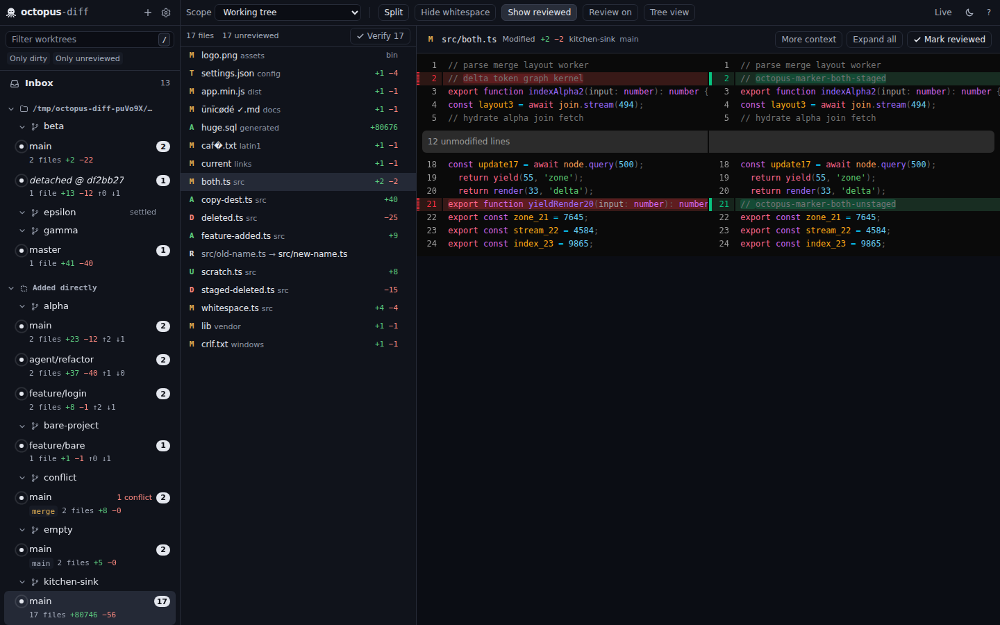
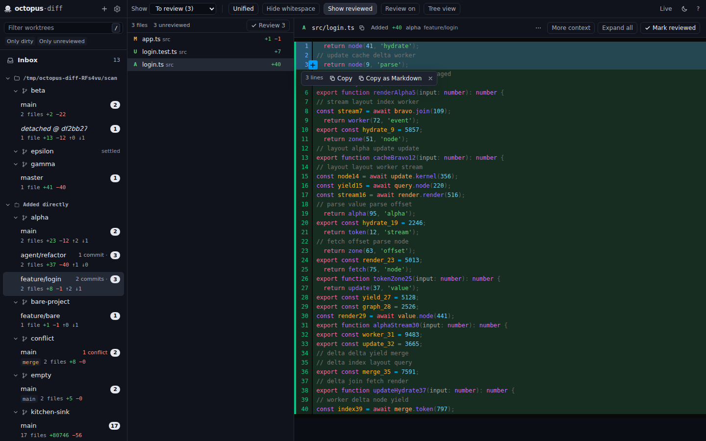
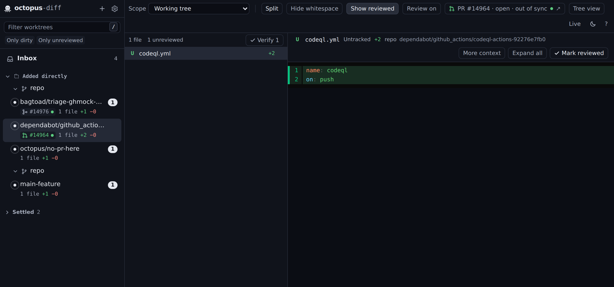
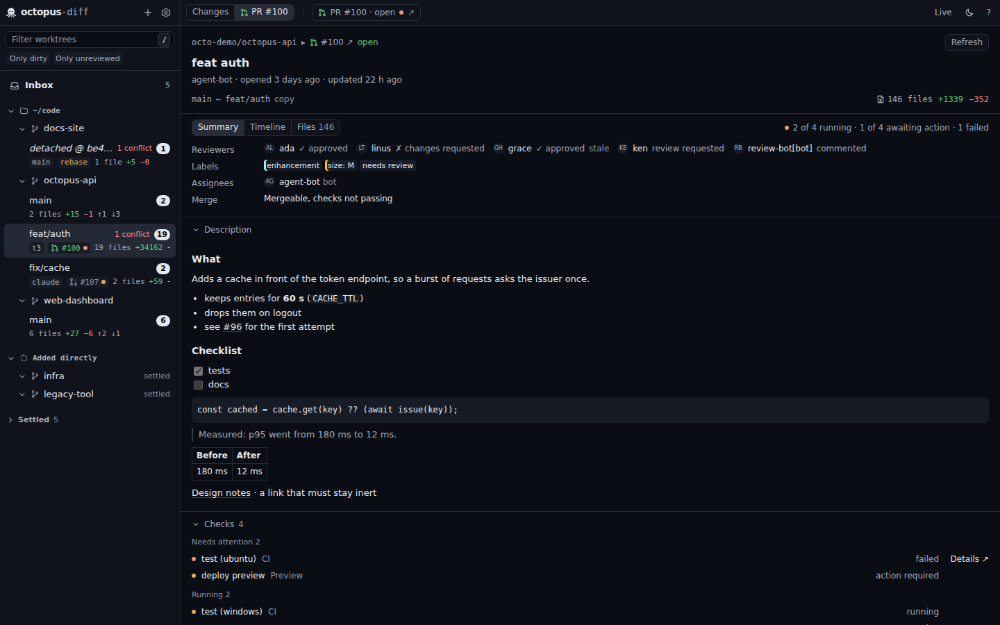
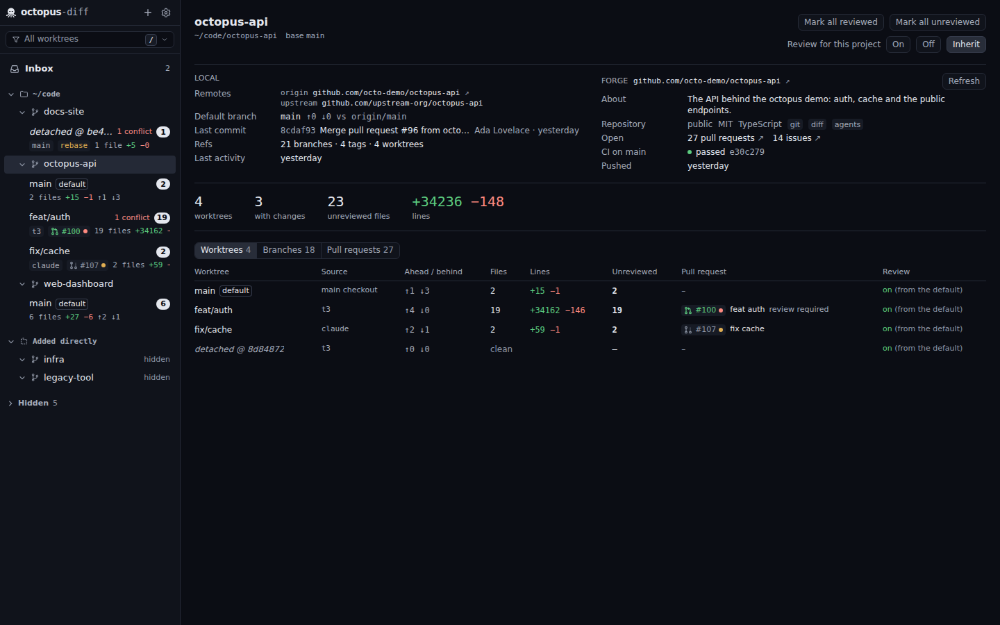

# octopus-diff

A **diff-first, read-only git UI that shows many projects and worktrees in one view**, built for the
era of coding agents that edit many repositories at once.

Coding agents (Claude Code, Codex, Cursor, T3 Code, Conductor, …) edit code in many repos and many git
worktrees at the same time. You no longer live in an editor, but you still need to answer three
questions. octopus-diff answers them in one browser window:

1. **What changed, across everything I have, since I last looked?** A cross-project *Inbox* of every
   dirty worktree.
2. **What exactly is the diff?** The diff is the main screen: split or unified, five scopes
   (working tree, staged, unstaged, branch vs. its base, single commit).
3. **Where am I?** Repository, worktree, branch, ahead/behind, and dirty counts for each worktree.

It is **agent-agnostic**: it only speaks git, so it works with any tool that edits files or creates
worktrees. Worktrees are discovered automatically, and edits show up live without a reload. Files you
mark as reviewed stay reviewed until their patch changes, then come back as unreviewed. You steer the
review loop: verify a whole worktree, project or folder in one click (with undo), or switch review
off where you do not want it.



> **Status: MVP.** Everything below is implemented and covered by unit and end-to-end tests. What
> works, measured performance and known gaps are in [`docs/reports/mvp.md`](docs/reports/mvp.md); the
> design and the acceptance list are in [`docs/PLAN.md`](docs/PLAN.md).

## Why it is safe to point at your repositories

octopus-diff **never writes to a repository**: no stage, commit, checkout, fetch, or even an index
refresh. This is enforced in code and tested, not just promised:

- All git access goes through one runner that only allows read-only subcommands (`status`, `diff`,
  `diff-index`, `diff-tree`, `rev-parse`, `rev-list`, `merge-base`, `worktree list`, `for-each-ref`,
  `symbolic-ref`, `show`, `cat-file`, `ls-files`, `log`, `config --get`). Anything else is rejected.
- Every call runs with `--no-optional-locks` and `GIT_OPTIONAL_LOCKS=0`, so a read never takes
  `index.lock` and never collides with an agent running git at the same moment. Also
  `GIT_TERMINAL_PROMPT=0`, `GIT_PAGER=cat`, `LC_ALL=C`, and `--no-ext-diff --no-textconv` on diffs.
- git is spawned with an argument array, never through a shell. Refs and paths from requests are
  validated, and `--end-of-options` / `--` separators keep user input from being read as options.
  Repository config is treated as untrusted.
- Proof tests run the whole app against fixture repositories and assert that no `index.lock` was
  created and that `.git/index`, refs and `git status` are unchanged.

octopus-diff's own state (the access token, the project list, review marks) lives outside your
repositories, in `~/.local/state/octopus-diff/`.

## Requirements

- **Node.js ≥ 24**
- **git ≥ 2.31** (older versions are refused; newer features such as `worktree list -z` from 2.36 are detected)
- Linux, macOS, or Windows via WSL2. Native Windows is untested.
- For development: **pnpm 12**

## Install

octopus-diff is not published to npm yet. Run it from a checkout:

```sh
git clone <this repository> octopus-diff
cd octopus-diff
pnpm install
pnpm build
node apps/cli/dist/index.js serve
```

To get an `octopus-diff` command on your `PATH`, link the CLI package: `cd apps/cli && pnpm link
--global`. A self-contained tarball (one bundled file plus the web UI) can be built with
`pnpm --filter octopus-diff run pack:tarball` and installed with `npm install -g
apps/cli/.pack/octopus-diff-<version>.tgz`. Once the package is published, `npx octopus-diff` will be
enough.

## Usage

```sh
octopus-diff serve                  # start on http://127.0.0.1:7428 and print the URL to open
octopus-diff serve --open           # … and open it in your browser
octopus-diff serve ~/code/app ~/code/lib --scan ~/work --depth 2
octopus-diff add ~/code/other       # register a repository with the running daemon
octopus-diff add --scan ~/agents    # add a scan root (discovers repositories below it)
octopus-diff status                 # is it running? prints the URL again
octopus-diff doctor                 # check git, Node, inotify limits, WSL, paths, port, web assets
octopus-diff token --rotate         # replace the access token (then restart the daemon)
```

`serve` is also the default command, so plain `octopus-diff` starts the daemon.

`serve` prints a line like this:

```
  Open:   http://127.0.0.1:7428/#token=3f9c…
```

Open that URL. The page keeps the token in the browser's `localStorage` for that address and removes
it from the address bar; later visits to `http://127.0.0.1:7428/` (and new tabs) stay signed in.
**Treat the URL like a password**: anyone with it can read the diffs of every registered repository.
Stop the daemon with Ctrl+C.

With `--host 0.0.0.0` or `--host ::` (plus `--allow-non-loopback`), `serve` and `status` also print
one `LAN:` URL per network address of the machine, since a `127.0.0.1` URL does not work on other
devices. That traffic is plain HTTP: use it only on a network you trust.

A *project* is a git repository. You can add any directory inside it, including a linked worktree;
all of the repository's worktrees are discovered automatically (T3 Code's `~/.t3/worktrees`, Claude
Code's `.claude/worktrees`, Conductor, Codex and hand-made worktrees alike). A *scan root* is a
directory that is searched for repositories down to a depth (default 3, max 8), skipping
`node_modules` and similar.

In the UI, **Watch a folder or add a repository** (the `+` in the sidebar header, the empty screen, or Settings →
Folders) opens a folder picker that browses the daemon's machine. Click a folder to open it, or type a
path: the part after the last `/` filters the list, `Tab` completes, and typing `.` shows hidden
folders. Repositories and linked worktrees are marked, and a repository can be added straight from its
row; `Enter` (or `Ctrl/Cmd+Enter` while a row is highlighted) adds or watches the folder in the path.
Adding a repository opens it, and picking one that is already added opens it instead. A path pasted
from Finder, Explorer or a shell (`'/a b'`, `/a\ b`, `"C:\a b"`) replaces the text and is unquoted, and
a `\\wsl.localhost\…` path copied from Windows Explorer becomes the Linux path when the daemon runs
in WSL. `./` and `../` start from the repository you are looking at. The command palette (`Ctrl/Cmd+K`)
browses the same way as soon as you type a path (`~/`, `/`, `./`), or pick **Add repositories…** in it.
Settings → Folders → **Start browsing in** sets where the picker opens (default `~/`).

### Review controls, settings and themes

- **The sidebar is your folders and projects, with the open work under them.** Under the Inbox (and anything
  you pinned), each watched folder lists its repositories, and each repository lists the worktrees that are
  still open: unreviewed files, a conflict or an operation in progress. Everything else (`clean`, `verified`,
  `review off`, `missing`) sits in the **Settled** shelf at the bottom, closed by default with a count; a
  project whose worktrees all settled just says `settled`. Hover a row for the check that settles it by hand
  (or the arrow that brings it back); the next change to that worktree un-settles it automatically, as does a
  new patch after you verified everything. Blocked work never settles. Click a folder or repository for its
  Overview, right-click for the actions, and pin a worktree to keep it at the top. Each worktree is a
  small card: the branch, then its files, `+adds −dels` and ahead/behind; hover a moment for the full details.
- **Mark all as verified.** The button above the file list marks every file you can see (respecting the
  sidebar filters); in the Inbox it marks everything. `Shift+R` does the same from the keyboard, and the
  context menu of a worktree, project or folder (and the folder Overview) can mark that whole level, or
  clear it again ("Mark all as unreviewed"). A toast offers **Undo** (also `Ctrl/Cmd+Z`) for ten minutes.
  A worktree that changed after you last looked is skipped and reported, so you never verify a diff you
  did not see.
- **Review on or off, per level.** The chip in the toolbar shows whether review is on for the selected
  worktree and where that comes from. You can turn it on or off for the worktree, its branch, its
  project, or the folder (scan root) it was discovered in; the most specific setting wins (worktree,
  then branch, project, folder, then the default). **Review is on by default**, which is what every new
  repository, worktree and branch gets; switch the default off in Settings to make review opt-in. A
  worktree with review off stays visible and diffable, but it has no unreviewed badges, `n` skips it and
  bulk actions leave it alone.
- **Settings** (`,` or the gear in the sidebar): General, Review (the default and every override),
  Appearance, Folders (scan roots and projects), Forges, Keyboard and About. Review settings are stored by the
  daemon and shared by every browser that opens it; appearance and layout preferences are stored in the
  browser, per device. The **command palette** (`Ctrl/Cmd+K`) jumps to any worktree, project or folder
  and runs any command.
- **Copy anything you are reading.** Right-click a worktree for its branch name, worktree path or commit id;
  right-click a file (list or tree) for its path, old path, name or absolute path; the diff header has a
  copy-path button and a `⋯` menu (also the whole file's patch), and the palette has the same commands.
  Press on a line number in the diff and drag to select lines: a small bar offers **Copy** (just the code)
  and **Copy as Markdown** (a fenced block headed by the file, line range, branch, worktree, scope and HEAD,
  ready for an issue or an agent prompt); `Ctrl/Cmd+C` copies the selected lines too. Copies keep
  invisible or bidirectional characters escaped as `⟨U+…⟩`, and work on a plain-http LAN address as well.

  
- **Pull and merge requests.** If the GitHub CLI (`gh`) or GitLab CLI (`glab`) is installed and signed in,
  each worktree on a feature branch shows its PR/MR next to the branch: number, open / draft / merged /
  closed, and a CI dot; the tooltip adds the review decision, conflicts and whether the request's head
  matches your HEAD, and the toolbar links to it. Forges are found from your remotes (github.com, GitHub
  Enterprise, gitlab.com, self-managed GitLab, ssh aliases, forks through `upstream`) with no setup;
  Settings → Forges shows what was found, turns the feature off, or names a host by hand. Read-only:
  octopus-diff only runs the CLIs' query commands and never sees a token. Details:
  [`docs/FORGES.md`](docs/FORGES.md).

  
- **The Request tab.** A worktree whose branch has a PR/MR gets a `Changes | PR #12` switch in the
  toolbar. The Request tab shows, read-only: reviewers (with `stale` verdicts), labels and mergeability;
  the description (markdown, no raw HTML); the checks grouped as *needs attention*, *running* and
  *passed*, refreshed while they run; the conversation (comments, reviews, review threads, with filters
  and paging); a timeline; and the changed files, marking the ones also changed in your worktree (click
  one to see your local diff). Hovering a sidebar row shows the request's size, CI, review and merge
  state without asking the forge again.

  
- **Repository information on the Overviews.** A project's Overview shows its remotes, default branch
  (with ahead/behind as of the last fetch), last commit, branch and tag counts, and, from the forge, the
  description, visibility, open PR and issue counts, default-branch CI and the newest open requests,
  each linked to its worktree when you have it checked out. A folder's Overview adds the default branch,
  last commit, forge and open requests per repository without asking any forge.

  
- **Themes.** Octopus Dark, Octopus Light and a high-contrast theme; "System" follows the OS. Themes
  are plain data files, so adding one is a one-file change: see [`docs/design/THEMING.md`](docs/design/THEMING.md).
  The identity and palette are described in [`docs/design/IDENTITY.md`](docs/design/IDENTITY.md).

### Commands and options

| Command | Options |
|---|---|
| `serve [path…]` | `-p, --port <n>` (default 7428, `0` = any free port) · `--host <addr>` (default `127.0.0.1`) · `--allow-non-loopback` · `--allowed-host <name>`… · `-o, --open` / `--no-open` · `-s, --scan <dir>`… · `-d, --depth <n>` · `--watch` / `--no-watch` · `--poll` · `--web-root <dir>` |
| `add <path…>` | `-s, --scan <dir>`… · `-d, --depth <n>` · `--url <url>` · `-p, --port <n>` · `--host <addr>` |
| `status` | `-o, --open` · `--json` · `--url <url>` · `-p, --port <n>` · `--host <addr>` |
| `doctor` | `--json` · `-p, --port <n>` · `--host <addr>` · `--web-root <dir>` |
| `config` | `--path` (print the config file path) · `--schema` (print its JSON Schema) |
| `token` | `--rotate` (replace the access token; without it, shows where the token file is) |
| every command | `-c, --config <file>` · `--config-dir <dir>` · `--state-dir <dir>` · `--log-level debug\|info\|warn\|error\|silent` · `-h, --help` |

`octopus-diff help <command>` prints the details. Exit codes: `0` success, `1` failure (daemon not
running, port in use, a `doctor` check failed, …), `2` bad command line or invalid config file.

`add` and `status` talk to the daemon that `serve` started: `serve` records its address in
`<state dir>/daemon.json`, and the token is read from `<state dir>/token`. Before sending the token,
they check that the daemon proves it holds the same token (see the security model); otherwise they
refuse. If no daemon is running, `add` says so and exits 1; start one with `octopus-diff serve` (paths
given to `serve` or listed in the config file are registered at startup).

### Configuration file

Optional: `~/.config/octopus-diff/config.json` (or `$XDG_CONFIG_HOME/octopus-diff/config.json`, or
`--config <file>`). Command-line flags win over the file; list flags (`--scan`, project paths,
`--allowed-host`) are added to the lists from the file. Relative paths in the file are relative to the
file; `~` is expanded. Unknown keys are an error, so typos don't silently do nothing.
`octopus-diff config --schema` prints the JSON Schema, and `octopus-diff config` shows the file that
was read and the effective values.

```jsonc
{
  "port": 7428,                    // 0 = any free port
  "host": "127.0.0.1",
  "open": true,                    // open the browser on `serve`
  "projects": ["~/code/app", "~/code/lib"],
  "scanRoots": ["~/.t3/worktrees", { "path": "~/work", "depth": 2 }],
  "scanDepth": 3,                  // depth for scan roots without one (0–8)
  "watch": {
    "enabled": true,               // false = poll + manual refresh only
    "forcePolling": false,         // true = never use native watchers (WSL /mnt/*, NFS)
    "ignore": ["vendor", ".venv"], // added to the built-in ignores (.git, node_modules, caches);
                                   // dist/build/out/target/coverage are skipped only where git ignores
                                   // them; add e.g. "build" here to skip a huge untracked build tree
    "debounceMs": 200,             // 150–300
    "pollFocusedMs": 30000,
    "pollIdleMs": 300000
  },
  "git": { "gitBinary": "git", "concurrency": 4, "timeoutMs": 15000 },
  "logLevel": "info",
  "allowNonLoopback": false,
  "allowedHosts": [],
  "stateDir": "~/.local/state/octopus-diff"
}
```

The real file is plain JSON (no comments). `webRoot` (a directory with a built web UI) overrides the
bundled UI; omit it normally.

### Files

| Path | What |
|---|---|
| `~/.config/octopus-diff/config.json` | optional config file (`$XDG_CONFIG_HOME`) |
| `~/.local/state/octopus-diff/token` | access token, mode 0600 (`$XDG_STATE_HOME`) |
| `~/.local/state/octopus-diff/daemon.json` | address and pid of the running daemon (removed on exit) |
| `~/.local/state/octopus-diff/open-*.html` | short-lived page `--open` hands to the browser opener (mode 0600, deleted after a minute) |
| `~/.local/state/octopus-diff/` | project registry and review marks (SQLite) |

## Security model

The daemon serves the contents of your repositories over HTTP, so it is locked down by default:

- **Loopback only.** It binds `127.0.0.1` by default. Binding anything else requires
  `--allow-non-loopback` (or `"allowNonLoopback": true`); `serve` refuses otherwise. Do this only on a
  network you trust.
- **Folder names are visible to the token holder.** The folder picker lists subfolder names anywhere
  the daemon's user can read (names only, no file names or contents, no git process). That is no new
  exposure: the same token can already add any repository on the machine and read its diffs.
- **Per-install token, bearer only.** A random token is created in `<state dir>/token` (mode 0600).
  Every API request, including the live event stream, needs `Authorization: Bearer <token>`. Only
  `/api/health` is unauthenticated, and the static files of the web UI (they contain no data).
- **No cookies.** Browsers send a cookie to *every* port on the same host, so a cookie holding the
  token would leak to any other local web server you visit. Instead, the printed URL carries the
  token in its fragment (`#token=…`), which browsers never send to a server, log, or put in a
  `Referer`. The web app moves it into `localStorage` (which is scoped to the exact origin, port
  included), strips it from the address bar, and sends it as a bearer header. Old `?token=` links
  redirect to `#token=`. If a browser still has the cookie an older version set, the daemon expires it.
- **The CLI checks the daemon before trusting it.** Another local user could start a fake server on
  the daemon's port. `status`, `add` and `serve` (when a daemon is already running) first call
  `/api/health?challenge=<random>`; the daemon answers with an HMAC-SHA256 of the challenge keyed by
  the token. Only a daemon whose answer matches gets the token or has its URL printed or opened.
- **The URL stays off command lines.** `--open` gives the browser opener a short-lived 0600 file in
  the state directory that redirects to the URL (on WSL, PowerShell gets the URL on stdin), because
  other local users can read a process's command line. Openers and `doctor`'s `git` are resolved to
  absolute paths from the absolute `PATH` entries only, never from the current directory.
- **Rotating the token.** `octopus-diff token --rotate` writes a new token. A running daemon keeps
  the old one until it restarts: stop it and run `octopus-diff serve` again, then open the new URL.
  Browsers signed in with the old token must open the new URL too. If the daemon finds its token file
  readable or writable by other users, it replaces the token (the old one may have been copied) and
  logs a warning.
- **Host and Origin checks.** The `Host` header must be a loopback name or address (or one listed in
  `--allowed-host`), which defeats DNS-rebinding attacks. A request with an `Origin` header must come
  from the daemon's own origin, so other websites open in your browser cannot read your diffs.
- **Forge CLIs are sandboxed like git.** `gh` and `glab` run only with built-in read-only GraphQL
  queries (an exact allowlist), outside your repositories, and only against hosts they are already
  signed in to; `GH_ENTERPRISE_TOKEN` / `GITLAB_TOKEN` from the environment are passed only for their own
  host, so a crafted remote URL cannot collect them. Turn the feature off in Settings → Forges.
- **Forge images are opt-out.** Avatars and pictures in PR descriptions load only from the forge hosts
  `gh`/`glab` are signed in to (the page's Content-Security-Policy names exactly those hosts), without a
  referrer; everything else shows as a link. Settings → Forges → "Load images from the forges" turns
  this off and restores the strict policy.
- **No write endpoints toward repositories.** The only writes are octopus-diff's own state (project
  list, review marks, focus) in the state directory.

`octopus-diff doctor` checks that the token file is not readable by other users. Output printed by
the CLI has terminal control and bidi characters escaped, since repository names and paths come
from repository content.

## Platform notes

### Linux: inotify limits

Live updates use native file watchers. With many worktrees, Linux's inotify limits can run out; the
daemon then logs a warning and falls back to polling. `octopus-diff doctor` shows the current limits
and the fix:

```sh
printf 'fs.inotify.max_user_watches=524288\nfs.inotify.max_user_instances=512\n' \
  | sudo tee /etc/sysctl.d/60-octopus-diff.conf && sudo sysctl --system
```

### WSL

- Keep repositories in the Linux filesystem (e.g. `~/code`). On `/mnt/c/…` (Windows drives) git is
  much slower, and file watching does not see edits made by Windows programs. If you must use
  `/mnt/*`, run `serve --poll` (or set `"watch": { "forcePolling": true }`).
- `--open` opens your Windows browser through PowerShell (`Start-Process`, with the URL on stdin),
  falling back to `xdg-open`. The URL works from Windows because WSL2 forwards `localhost`.
- Without systemd, `/etc/sysctl.d` is not applied at WSL start; run `sudo sysctl --system` after each
  start or add it to the `[boot]` command in `/etc/wsl.conf`.

## Limitations

- **Read-only by design**: no staging, committing, discarding, pushing or conflict resolution. Use
  your agent, editor, lazygit or the git CLI for that.
- No history graph and no fetching: ahead/behind counts use local refs only. Forge support is read-only
  for GitHub and GitLab (no creating, merging, approving or commenting; no Bitbucket, Azure DevOps or
  Gitea). The Request tab loads the first page of each list (100 files, 100 commits, 50 conversations)
  and links to the forge for the rest; it never shows the forge's diff.
- Very large diffs are capped and shown as "too large" placeholders (you can load them on demand);
  binary files are shown as binary.
- One machine: the browser and the repositories must be on the machine running the daemon (or reach
  it over a trusted network with `--allow-non-loopback`).
- Folders are watched for repositories, not browsed: viewing a whole folder's files (read-only) is
  designed in [`docs/design/FOLDERS.md`](docs/design/FOLDERS.md) but not built.
- Undo for "Mark all as verified" is kept in the daemon's memory for ten minutes and is lost when it
  restarts.
- Not published to npm yet; no desktop app yet.

## Development

```sh
pnpm install
pnpm check      # lint + typecheck + build + unit tests
pnpm test:e2e   # Playwright end-to-end tests
```

See [CONTRIBUTING.md](CONTRIBUTING.md) for the layout, conventions and the read-only rules, and
[AGENTS.md](AGENTS.md) for the rules that coding agents working on this repository follow.

## Credits

octopus-diff is built on open-source software. **Settings → About** lists every package it uses,
with its version, license and license text, the code adapted from other projects (notably
[T3 Code](https://github.com/pingdotgg/t3code), MIT) and git, which it runs.
[CREDITS.md](CREDITS.md) has the same list.

## License

MIT
