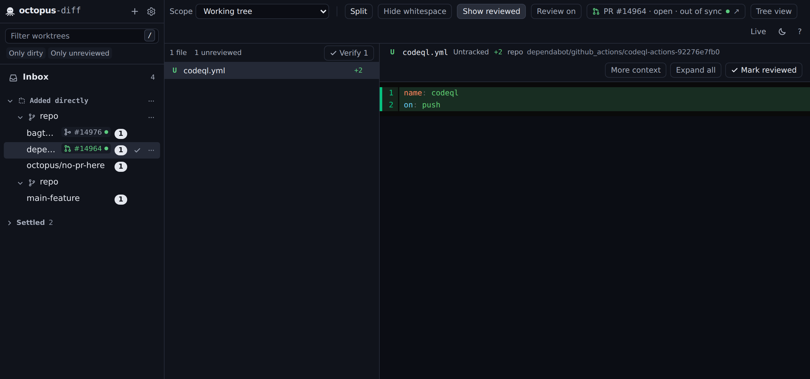

# Forges: pull and merge requests (GitHub via `gh`, GitLab via `glab`)

> Added 2026-11-09 (branch `feat/forges`). Decisions #61–#70 in `docs/DECISIONS.md`. Report:
> `docs/reports/forges.md`.

octopus-diff shows, for every worktree on a feature branch, the pull request (GitHub) or merge request
(GitLab) that branch belongs to: its number, state (open, draft, merged, closed), CI, review decision,
conflicts and whether its head matches the worktree's HEAD. It uses the `gh` and `glab` CLIs the user is
already signed in to. It is **read-only**: octopus-diff never creates, edits, merges or comments, and never
reads, stores or forwards a token.



The design follows T3 Code's source-control layer (`~/contrib/t3code/packages/source-control-*`, MIT;
ideas and two small adapted parsers, attributed in comments), scaled down to what a read-only,
many-worktree tool needs.

## What is shown

| Where | What |
|---|---|
| Sidebar row, Overview row | Chip after the branch: PR/MR glyph (open, draft, merged, closed), `#123` / `!123`, a CI dot (green passed, red failed, amber running). Tooltip: title, `head → base`, author, CI counts, review, conflicts, comments, "head differs from HEAD". |
| Toolbar (selected worktree) | Link to the request on its forge: `PR #123 · open · changes requested · out of sync ↗`. |
| Settings → Forges | On/off switch, `gh`/`glab` status (version, signed-in hosts, install/login hint), each repository's forge and status, host overrides, "Check again". |

Colour follows the identity rule (hues belong to the diff): only "open" (`add`) and the CI dot are
coloured; draft, merged and closed stay in the ink scale. T3 Code colours merged violet and closed red;
we deliberately do not.

## Pipeline

```
project (git-core readRemoteConfig: one `git config --get-regexp`)
  └─ remotes (insteadOf applied) ──▶ parse URL ──▶ host + path   (ssh aliases from ~/.ssh/config)
        └─ classify host: setting override ▶ hostname rule ▶ CLI login       (packages/forge/src/host.ts)
              └─ base repository: gh-resolved mark ▶ upstream ▶ github/gitlab ▶ origin ▶ others
worktrees on non-default branches
  └─ head branch (branch.<b>.merge when pushing to the tracked remote) + push repository
        └─ one GraphQL query per repository (all branches as aliases)       (gh/glab api graphql)
              └─ match: same head branch AND (push repository, or same-repo when unknown)
                    └─ open first, else the newest merged/closed
```

### 1. Discovery

- **Remotes** come from git-core's new `readRemoteConfig` (the existing allowlisted
  `git config --null --get-regexp`): `remote.*.url|pushurl|gh-resolved`, `remote.pushDefault`,
  `branch.*.remote|merge|pushRemote`, `url.*.insteadOf|pushInsteadOf`. Rewrites are applied the way
  `git remote get-url` would. No new git subcommand, nothing fetched.
- **URLs**: `https://`, `ssh://`, `git://`, scp-like `git@host:path`. Local paths, `file://`, `ext::` and
  anything whose host is not a bare hostname or whose path is not `seg/seg[/…]` are ignored. An ssh host
  alias (`git@github-work:me/app`) is mapped through literal `Host`/`HostName` pairs in `~/.ssh/config`.
- **Which forge** (first match wins):
  1. `AppSettings.forges.hosts[host]`: `github`, `gitlab` or `none` (never query);
  2. the hostname: `github.com`, `*.ghe.com`, any `github` label → GitHub; `gitlab.com`, any `gitlab`
     label → GitLab (T3 Code's rules);
  3. the CLIs' logins: a host `gh auth status` / `glab auth status` reports as signed in. This is how a
     self-managed GitLab or GitHub Enterprise on a neutral hostname is found without configuration.
- **Which repository** requests live in: `gh`'s own order. A single `remote.<r>.gh-resolved` mark
  (`gh repo set-default`) wins, else the recognised remotes ranked `upstream` > `github`/`gitlab` >
  `origin` > others. So a fork's PRs are looked up in the upstream.

### 2. CLI status

`gh --version` + `gh auth status`, `glab --version` + `glab auth status --all` (retried without
`--all` for glab < 1.79). Text output is parsed (`gh auth status --json` needs gh ≥ 2.81; Ubuntu ships
2.46). Probes are cached 10 minutes (30 s on "Check again"). **The CLIs are started only once some
project has a remote on a host**, so offline setups and the test fixtures never run them.

### 3. Fetching

One GraphQL query per repository and refresh, with each branch as an aliased connection
(`b0: pullRequests(headRefName: $b0, first: 5, orderBy: UPDATED_AT DESC)`; GitLab:
`mergeRequests(sourceBranches: [$b0], first: 5, sort: UPDATED_DESC)`), batches of 20 branches.
Measured: 1 GitHub rate-limit point per repository per refresh.

- GitHub fields: number, title, url, state, isDraft, base/head ref, head oid, isCrossRepository,
  headRepository, author, reviewDecision, mergeable, totalCommentsCount, and the head commit's
  `statusCheckRollup` state with `checkRunCountsByState` / `statusContextCountsByState` (counts without
  listing every check).
- GitLab fields: iid, title, webUrl, state, draft, target/source branch, diffHeadSha, author, source and
  target project, userNotesCount, headPipeline.status, conflicts, approved + approvedBy, detailedMergeStatus.
  If a self-managed GitLab rejects unknown fields, the query is retried with a basic field set.
- Only branches checked out in worktrees are asked about, never the default branch (forks reuse `main`).
- When: on daemon start; 1.5 s after a worktree/project is added, removed or updated or a branch
  changes; every 2 minutes; on "Check again" (`POST /api/forges/refresh`). At most once per 15 s per
  project unless forced. A failed fetch keeps the last good data and reports `error`.

### 4. Matching

For a worktree on local branch `b`: the head branch is `branch.b.merge` when the branch pushes to the
remote it tracks, else `b`; the push repository is the URL of `branch.b.pushRemote` > `remote.pushDefault`
> `branch.b.remote` > `origin`, if it is on the forge's host. A request matches when its head branch
is that name and it comes from the push repository (or, with no known push repository, from the base
repository itself). Same-named branches in strangers' forks never match. Then: an open request (newest
first), else the most recently updated merged or closed one. `sync` compares the request's head commit
with the worktree's HEAD (`same` / `differs`; local refs only).

## Safety

The read-only guarantee (PLAN §5.5) is extended to the forge CLIs, in `packages/forge/src/cli.ts`:

- **One runner, argument allowlist.** Allowed: `--version`; `auth status [--hostname <h>]` (glab also
  `--all`); `api graphql --hostname <h> --raw-field query=<Q> --raw-field <var>=<value>…` where `Q` must
  equal, byte for byte, one of the queries built by `buildGithubQuery(n)` / `buildGitlabQuery(n, …)` for
  the number of branch variables given, and the variables are exactly `owner`/`name` (GitHub) or
  `fullPath` (GitLab) plus `b0…bN-1`. Rejected: any other subcommand, `--method`, `-F`/`--field` (which
  can read files), `--input`, `auth token`, `--show-token`, mutations, values with newlines or NUL.
- **Argv arrays, never a shell.** Branch names are GraphQL variables, never spliced into query text.
- **Neutral working directory** (the daemon's state dir): the CLIs never run inside a user repository,
  so they cannot read its (untrusted) config or run git there. Repositories are named explicitly.
- **Hardened environment**: `GH_PROMPT_DISABLED`, `GLAB_NO_PROMPT`, update notifiers off, pagers `cat`,
  `NO_COLOR`, `GIT_TERMINAL_PROMPT=0`; `GH_REPO`, `GITLAB_REPO`, `GH_DEBUG`, `GLAB_DEBUG_HTTP`, editors and
  browsers removed.
- **Tokens never travel to the wrong host.** `gh` sends `GH_ENTERPRISE_TOKEN` to any non-github.com host
  and `glab` sends `GITLAB_TOKEN` to whatever host it is asked about, so a crafted remote URL
  (`https://github.attacker.example/x/y`) could otherwise collect them. The runner keeps `GH_TOKEN` only
  for github.com / `*.ghe.com`, `GH_ENTERPRISE_TOKEN` only for the user's own `GH_HOST`, and `GITLAB_TOKEN`
  only for the user's `GITLAB_HOST` (gitlab.com when unset). And **a host is only ever queried when the
  CLI itself reports being signed in to it.**
- Hosts are validated as bare lower-case hostnames (`ForgeHostSchema`), timeouts 20 s, stdout cap 8 MiB,
  two processes per CLI. Auth output is never logged; error details skip token lines.
- The web UI opens request URLs only when they are `https://` (`target=_blank rel=noopener noreferrer`).

## API (additive; `packages/contracts/src/forge.ts`)

- `GET /api/forges` → `ForgesResponse { enabled, clis[], projects[{ projectId, forge, status, message,
  worktrees[{ worktreeId, branch, changeRequest, sync }], fetchedAt }], generatedAt }`. Served from the
  cache joined with the live worktree list; never waits on the network.
- `POST /api/forges/refresh { projectIds? }` → the same, after re-probing stale CLIs and refetching.
- SSE `forge.updated { projectIds }` (empty list = only the CLI status changed).
- `AppSettings.forges { enabled (default true), hosts: { [host]: 'github' | 'gitlab' | 'none' } }`,
  patched through `PATCH /api/settings`.
- `GitCore.readRemoteConfig?(project)` (optional on the interface, implemented by git-core).
- Project statuses: `ok`, `pending`, `disabled`, `no-forge`, `ignored`, `idle` (only the default
  branch checked out), `cli-missing`, `unauthenticated`, `error`.

## Packages

| Path | What |
|---|---|
| `packages/forge` (new) | `ForgeCli` (runner + allowlist + env), `ForgeClient` (probe, batched fetch, GitLab fallback), remote parsing and classification, ssh aliases, auth-status parser, GraphQL builders and normalisers, base-repository and branch resolution, matching. No daemon state. |
| `packages/git-core/src/remotes.ts` | `readRemoteConfig` + `parseRemoteConfig` / `rewriteUrl`. |
| `apps/daemon/src/forges.ts` | `ForgeService`: caches, scheduling, events, `GET`/`POST` handlers. `internal.forges` injects a fake client in tests (or `false` to not start it). |
| `apps/web/src/{api/forges.ts,lib/forge.ts,components/ChangeRequest.tsx,components/settings/ForgesSection.tsx}` | Query + SSE refetch, presentation, chip/badge, Settings panel. `mock/forges.ts` serves demo data. |

## Testing

- `packages/forge`: parsers against **real recorded responses** (`test/fixtures/github-batch.json` from
  `pingdotgg/t3code`, `gitlab-batch.json` from `gitlab-org/cli`, gh 2.46 /
  older gh / glab auth output); allowlist and env rules; the full client against fake `gh`/`glab`
  executables (argv, cwd and env recorded; old-glab `--all` retry; GitLab basic-query fallback; errors and
  timeouts). Opt-in live test: `OCTOPUS_FORGE_LIVE=1 [OCTOPUS_FORGE_GLAB=/path/to/glab] pnpm --filter
  @octopus-diff/forge test` (public repositories only).
- `apps/daemon/test/forges.test.ts`: fork matching, upstream selection, GitLab via CLI login,
  rate limiting and forced refresh, errors keep data, disabled, host overrides, and "no remote → no CLI
  ever started".
- `apps/web/test/forges.test.tsx`: chips for every look, toolbar link attributes, Settings toggling off
  removes every chip through `forge.updated`.

## Not done (on purpose or for later)

- No writes of any kind (merge, approve, comment, checkout): out of scope by PLAN §1.
- No other forges (Bitbucket, Azure DevOps, Forgejo/Gitea): T3 Code has them; the classification and
  runner are shaped so one more `kind` is a contained change.
- No "compare against the PR's base" scope yet: `ChangeRequest.baseBranch` is there for it, but the base
  usually needs a fetch to be current, and fetching is not read-only.
- No per-check list or review threads; no notifications.
- `sync` is `same`/`differs` only: telling "ahead" from "behind" needs the request's head object
  locally, which needs a fetch.
- GitLab is verified against gitlab.com's public GraphQL and the `glab` 1.128 binary, but not against a
  signed-in `glab` (none on the dev machine).
